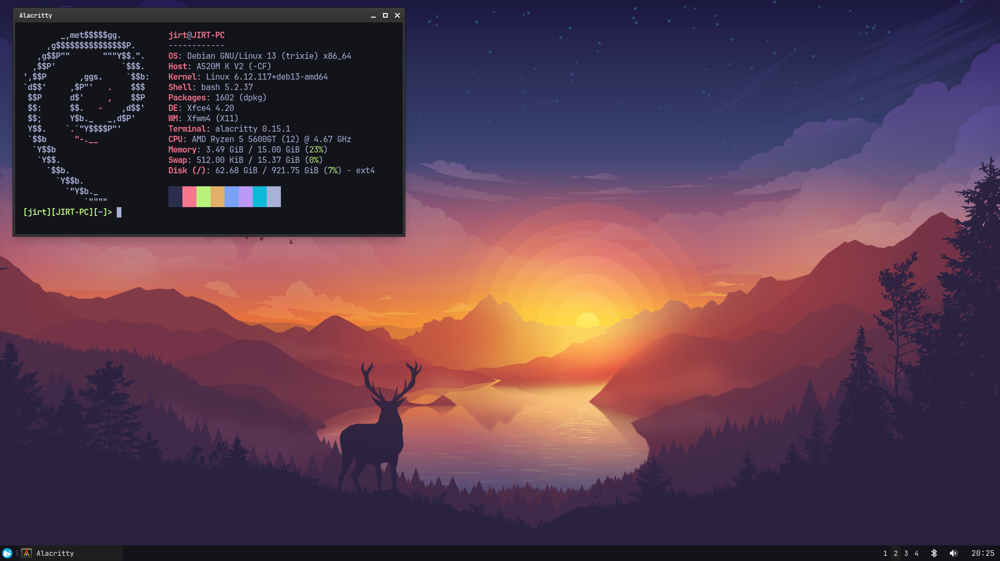

# CENTRIX
**Centrix** es una colección de scripts de **Bash** desarrollados para personalizar y configurar el entorno de escritorio **Xfce** en sistemas **Debian GNU/Linux**. El proyecto permite automatizar la instalación, limpieza y configuración de programas conforme a las preferencias y criterios definidos por su desarrollador, facilitando así la preparación de un entorno de escritorio personalizado.
El instalador ofrece flexibilidad permitiendo instalar programas varios seleccionados por el desarrollador.
**Centrix** ofrece compatibilidad para sistemas operativos **Debian GNU/Linux** y de misma forma a sistemas **Devuan**.



### INSPIRACIÓN
La creación del proyecto **Centrix** surge en base a proyecto de la misma indole, proyectos personales donde los/as respectivos/as creadores/as brindan un sistema operativo con base GNU/Linux a la comunidad en base a sus preferencias y como ellos ven el sistema operativo ideal (Sin animos de ofender). Algunos ejemplos muy claros son **Loc-OS**, **FLinux**, **Goldendog Linux**, **Omakub**, etc.

**Centrix** ofrece de misma forma una visión del creador de como deberian ser los sistemas GNU/Linux (Al menos a nivel de personalización).

### REQUISITOS
- Un sistema Debian/Devuan GNU/Linux instalado con el entorno de escritorio **Xfce** predeterminado.
- El programa Git instalado, para poder clonar el repositorio desde la plataforma **GitHub**.
- Conexión a Internet para descargar paquetes.

### ADVERTENCIA
**Centrix** va a instalar y eliminar paquetes del entorno de escritorio **Xfce**, así como modificar la configuración del sistema y el archivo `.bashrc`. 
Se recomienda encarecidamente revisar los scripts del proyecto antes de ejecutarlos y asegúrate de comprender las operaciones que realizan.

### INSTALACIÓN Y USO
```
git clone https://github.com/JIRT2007/centrix.git
./centrix/install.sh
```
El instalador de **Centrix** es muy intuitivo y ofrece una limpieza e instalación de programas al igual que ofrece la instalación de ciertos programas a elección del usuario final (Discord, Spotify, FreePascal, etc). De mismo modo al finalizar el instalador se ofrece la opción de configurar las credenciales locales de **Git**.

Si unicamente se desea aplicar la personalización basica del entorno **Xfce** puede ejecutar el script encargado de customizar el escritorio.
```
./centrix/SCRIPTS/desktop.sh
```
Tenga en consideración que esto no customizara el entorno con el paquete de iconos y tipografias seleccionadas por el proyecto **Centrix** solo se modificara el fondo de escritorio y el panel de **Xfce** con el contenido que ya venga incluido dentro del entorno.
Tampoco se eliminaran los paquetes considerados innecesarios ni se instalara la selección de software del proyecto (Vim, Fastfetch, Tmux, Btop, etc). 

### KEYBINDINGS:
- Whiskermenu: `Super/Windows`
- Xfce4-Appfinder: `Alt + W` 
- Emulador de terminal Alacritty: `Alt + Q`
- Cerrar ventanas: `Alt + C`
- Maximizar ventanas: `Alt + Up`
- Posicion derecha de ventanas: `Alt + Right`
- Posicion izquierda de ventanas: `Alt + Left`

### LICENCIA
**Centrix** está sujeto a las políticas de uso y distribución establecidas por la **Licencia Pública General v2.0**. Puedes consultar la documentación oficial en el sitio web del proyecto **GNU**: *https://www.gnu.org/licenses/old-licenses/gpl-2.0.html*
